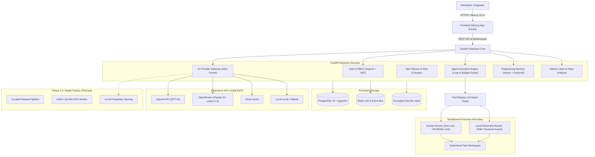
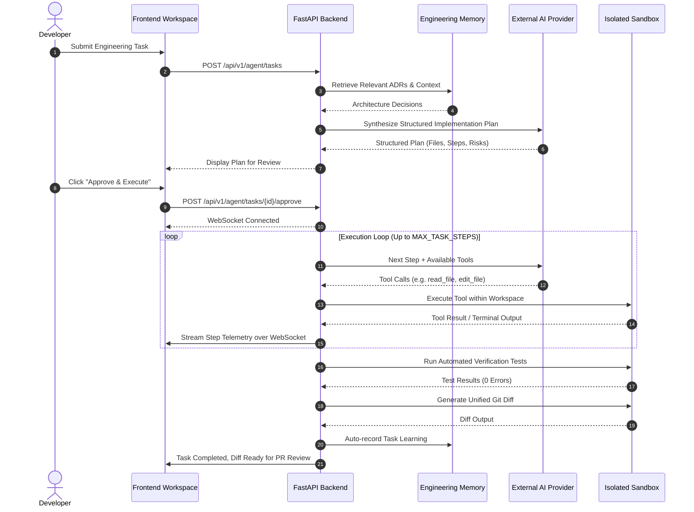

# JGitLab System Architecture

This document describes the architectural principles, module boundaries, data flows, and future migration paths of the **JGitLab** platform.

---

## 🏗️ High-Level System Architecture

---

## 🧩 Architectural Modules

### 1. Provider Abstraction (`app.services.ai`)
The core interface is `AIProvider`:
- `validate_connection() -> AIValidationResult`: Live healthcheck and model discovery.
- `generate_response(messages, tools, temperature, max_tokens) -> AIResponse`: Standard completion with tool call parsing.
- `generate_structured_response(messages, schema) -> Dict`: Schema-enforced JSON generation.
- `stream_response(messages, tools) -> AsyncGenerator[AIStreamChunk]`: Token streaming.
- `generate_embedding(text) -> List[float]`: Semantic representation for memory.

The initial implementation is `OpenAICompatibleProvider`. Because modern inference engines (vLLM, TensorRT-LLM, Ollama) and external model APIs (OpenAI, OpenRouter, Groq, DeepSeek) expose this interface, the Autonomous AI Engineer interacts purely with the abstraction. **Transitioning to proprietary fine-tuned weights in Phase 4 requires zero refactoring of agent planning or execution loops.**

### 2. Dual Sandbox Architecture (`app.services.sandbox`)
To prevent host contamination while enabling friction-free development:
- **Docker Runner**: Spins up ephemeral containers with `--memory=1024m`, `--cpus=1.0`, `--pids-limit=64`, and non-root user. Network access is restricted.
- **Local Restricted Runner**: Active in environments where the Docker daemon is inactive. Enforces strict boundary checks via `os.path.commonpath([workspace, target]) == workspace`. Blocks malicious system calls (`rm -rf /`, `mkfs`, fork bombs) and forbids reading/writing `.env` files.

### 3. Engineering Memory Pipeline (`app.services.memory`)
Project knowledge is indexed across 5 distinct categories:
- `architecture`: High-level structural invariants and boundaries.
- `adr`: Architecture Decision Records documenting context, decision, and consequences.
- `tech_stack`: Framework choices, package manifests, and runtime dependencies.
- `bug_fix`: Past issues and exact resolution strategies.
- `task_learning`: Auto-recorded task summaries and diff post-mortems.

When planning a task:
1. The user's prompt is embedded or tokenized.
2. Relevant memories are fetched via cosine similarity (with pgvector or vector math) or scored keyword matching.
3. Relevant memories are injected directly into the LLM system context, ensuring the agent adheres to existing architecture.

---

## 🔄 Agent Execution Lifecycle

